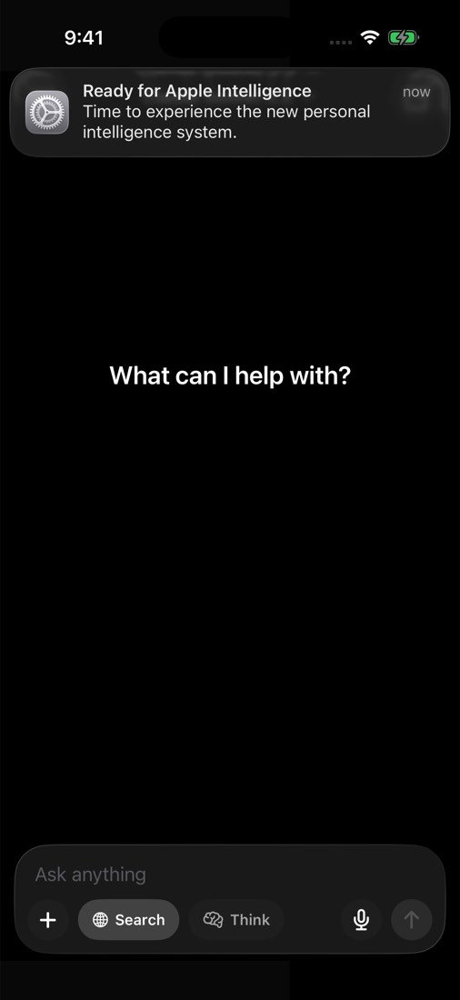
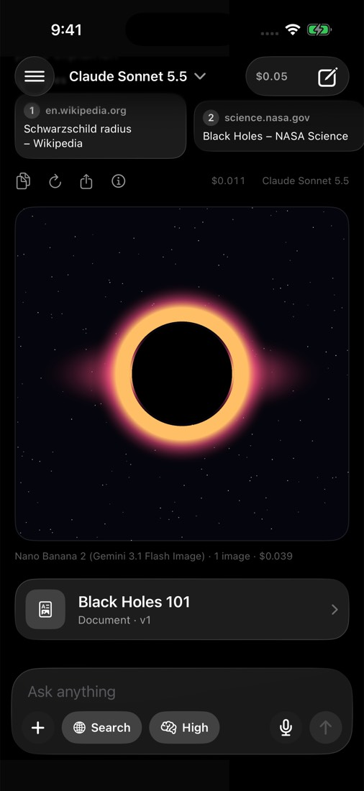
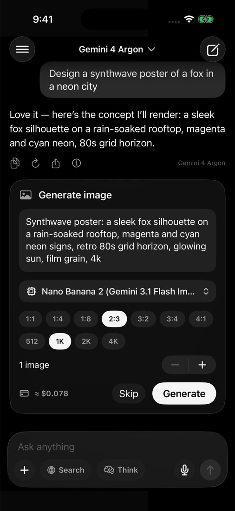
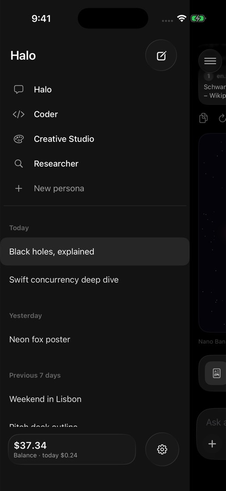
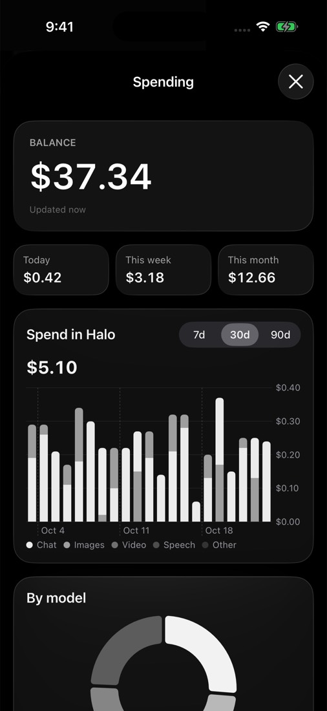

<p align="center"></p>

# Halo

A native iPhone chat app for [OpenRouter](https://openrouter.ai), with every frontier model in one place. Dark, monochrome design with one warm accent, built with SwiftUI and Liquid Glass for iOS 26 and later.

<p align="center">
  
  
  
</p>
<p align="center">
  
  
  
</p>

## Features

- **Any OpenRouter model**
  - A favorites dropdown in the top bar, plus a searchable catalog of all ~450 models with prices, context size and capability badges.
  - Switch models mid-chat, or regenerate a reply with a different one.
- **Tools the model can call**
  - 🖼 **Image generation and editing** through OpenRouter's image models. Each request shows an approval card first, where you can edit the prompt, pick a model, aspect ratio, resolution and count, and see a cost estimate.
  - 🎬 **Video generation** (Veo, Seedance, Kling, Wan…), also behind an approval card with duration, resolution and audio options. It shows live progress, and polling resumes if you leave the app.
  - 🔊 **Speech** with natural voices (Gemini TTS, ElevenLabs, …) and an inline player.
  - 🌐 **Web search** through OpenRouter's server tool, with inline citations and source cards.
  - 🐍 **Run code**: Python via Pyodide (numpy, pandas, matplotlib charts) and JavaScript, both on the device.
  - 📄 **Artifacts**: documents, programs, HTML pages, React apps, SVGs and Mermaid diagrams. They open in a full-screen canvas with live preview, versions, a diff view and export to Markdown, HTML or PDF.
- **Edit and branch**
  - Edit any message you sent and Halo replies again on a new branch. Regenerating a reply keeps the earlier one too.
  - Step between versions with the ‹ 2/3 › control under a message or reply.
- **Find and organize chats**
  - Search every chat by title or message text, including archived chats and other branches. Tapping a result jumps to the message.
  - Pin chats and set their order (Move up / Move down), or archive them out of the sidebar. Sending a message brings an archived chat back.
- **Reasoning**
  - A collapsible "thought process" for each reply.
  - A per-chat effort control: Low, Medium, High, Extra high or Max, depending on what the model supports.
- **Personas**: Halo, Coder, Creative Studio and Researcher, plus your own. Each has its own prompt, model, tools and effort.
- **Costs everywhere**
  - Your live balance.
  - A running cost for each chat in the header.
  - Per-message details: tokens, cached tokens, reasoning tokens, latency and tokens per second.
  - A spending dashboard with charts.
- **Attachments**
  - Photos and the camera, for vision models.
  - PDFs, read natively by the model or through OpenRouter's free parser or OCR.
  - Text and code files.
  - On-device voice dictation.
- **Background replies**: send a message and lock your phone, and Halo finishes the reply in the background and notifies you (details below).
- **Polish**: smooth adaptive streaming, haptics, Markdown with tables and task lists, LaTeX math, and syntax highlighting for about 20 languages.
- **Bring chats from openrouter.ai**: export a chat as Markdown on openrouter.ai, then open the file with Halo (share sheet or Files › Open in Halo) or use **Settings › Data › Import**, and keep talking where you left off.
- **Your data**: chats are stored on the device with SwiftData and your key is kept in the Keychain. An optional Face ID lock (Settings › Privacy) also hides your chats in the app switcher. You can export everything to a JSON backup or share any chat as Markdown.

## Run it in the simulator

1. Open `Halo.xcodeproj` in Xcode 26 or later.
2. Pick an **iPhone 17 Pro** simulator and press **⌘R**. Swift packages (swift-markdown, SwiftMath) resolve automatically on first open.
3. Tap **Sign in with OpenRouter**, or paste an API key from https://openrouter.ai/settings/keys.

**Demo mode**: to look around without a key or spending credits, open **Product › Scheme › Edit Scheme › Run › Arguments** and add `-demo`. To jump straight to a screen, also add `-demoScreen home|chat|sidebar|approval|artifact|spend|onboarding|settings|models|persona|details`. Remove these arguments before you use the app for real.

## Install it on your iPhone

1. Plug in your iPhone. If it isn't already on, enable **Developer Mode** on the phone (Settings › Privacy & Security).
2. In Xcode, select the **Halo** target, then **Signing & Capabilities**. Choose your **Team** (your paid developer account). If the bundle id `com.filip.halo` is taken, change it to something unique.
3. Select your iPhone as the run destination and press **⌘R**.

With a paid account the app stays installed for a year.

## The balance number

OpenRouter only gives your total account balance to a **Management key**. A normal or sign-in key can only see its own spend and limit.

- **With a management key**: create one at https://openrouter.ai/settings/management-keys and paste it into Halo's **Settings › Account**. Halo then shows your true balance.
- **Without one**: Halo shows the key's spend for today, this week and this month, plus its remaining limit if the key has one.

## How background replies work

iOS suspends normal network connections about 30 seconds after you leave an app. Halo handles this in three steps:

1. It keeps streaming for about 25 seconds after you leave.
2. If the reply still isn't done, it re-sends the request on a system **background URLSession**. This means the model writes the reply again from the start, and that full reply replaces what had streamed so far. The iOS networking daemon finishes the request even while Halo is suspended, and a notification arrives when the reply lands.
3. If the reply asks for a tool (an image, code, and so on), the notification says so, and the tool runs as soon as you open Halo. Image and video generation always wait for your approval.

Video jobs run on OpenRouter's servers, so a video keeps rendering while you're away and Halo picks it up when you return.

## Where model ratings come from

The image, video and voice pickers rank models by [Artificial Analysis](https://artificialanalysis.ai) arena Elo. Picks like "Best rated" and "Best value" come from those ratings. Tapping a chat model in the browser opens its detail page, which shows:

- AA's scores and their ranks, plus every benchmark behind them
- intelligence at each thinking effort
- measured speed
- a price-against-intelligence chart, with cheaper, smarter or faster alternatives

Where the data comes from:

- A workflow (`.github/workflows/media-arena.yml`) reads AA's free API twice a day.
- It matches each AA model to an OpenRouter model id and publishes two files on the `arena-data` branch: `media-arena.json` (media ratings) and `llm-stats.json` (chat model speed). Halo downloads both every 12 hours.
- Chat model benchmarks come from OpenRouter's Artificial Analysis feed, which Halo already reads.
- When the media file hasn't loaded yet, Halo falls back to the snapshot built into `MediaModelResearch.swift`.

To set it up, add a free AA API key as the repository secret `AA_API_KEY`, then run the workflow once from the Actions tab. Some AA models won't match an OpenRouter id by name. The workflow summary lists those, and you fix them in `tools/media-arena/overrides.json`.

## Project layout

```
Halo/
  App/         App entry, AppModel (dependencies + navigation)
  OpenRouter/  HTTP client, SSE parsing, Codable API types
  Chat/        ChatEngine (stream → tools → loop), request builder, tool executor, personas
  Code/        JS / Python runners, HTML / React / Mermaid preview templates
  Markdown/    Markdown → SwiftUI renderer, syntax highlighter, LaTeX
  Features/    All screens (chat, composer, sidebar, models, artifacts, settings, spend, …)
  Services/    Keychain, settings, catalog, account, media store, dictation, export, background runner
  Design/      Theme (colors, type), Liquid Glass helpers, the eclipse mark
HaloTests/     Unit tests (SSE, tool calls, partial JSON, titles, math, tokenizer, diff, React transform)
tools/media-arena/  Builds the media model ratings file (see above)
```

CI (`.github/workflows/ios.yml`) builds the app and runs the unit tests on macOS for every push. A commit message containing `[shots]` also makes it capture demo-mode screenshots.
